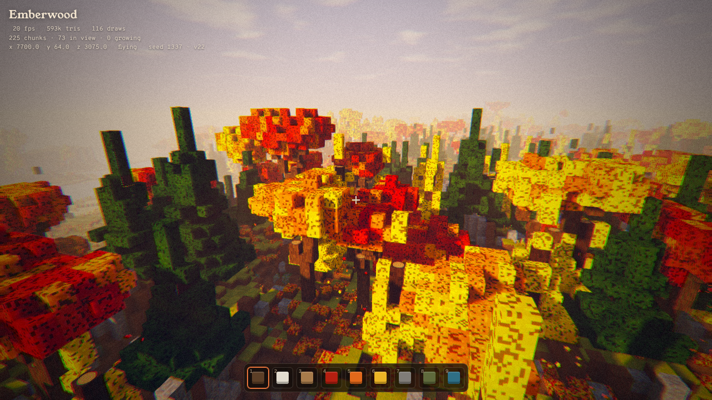

# Emberwood

A voxel autumn forest on a simulated planet (plate tectonics, climate, erosion, rivers, weather), written in plain JavaScript and raw WebGL2 with no libraries.



## Build

```
node build.mjs
```

This inlines `src/` into a single self-contained `index.html` (and `emberwood.html`, the page body without the html/head wrapper). Open `index.html` in a browser with WebGL2.

`VERSION` is shown in the HUD; bump it when shipping a new build.

## Deploy

Every push to `main` runs `.github/workflows/pages.yml`, which builds and deploys `index.html` to GitHub Pages.
